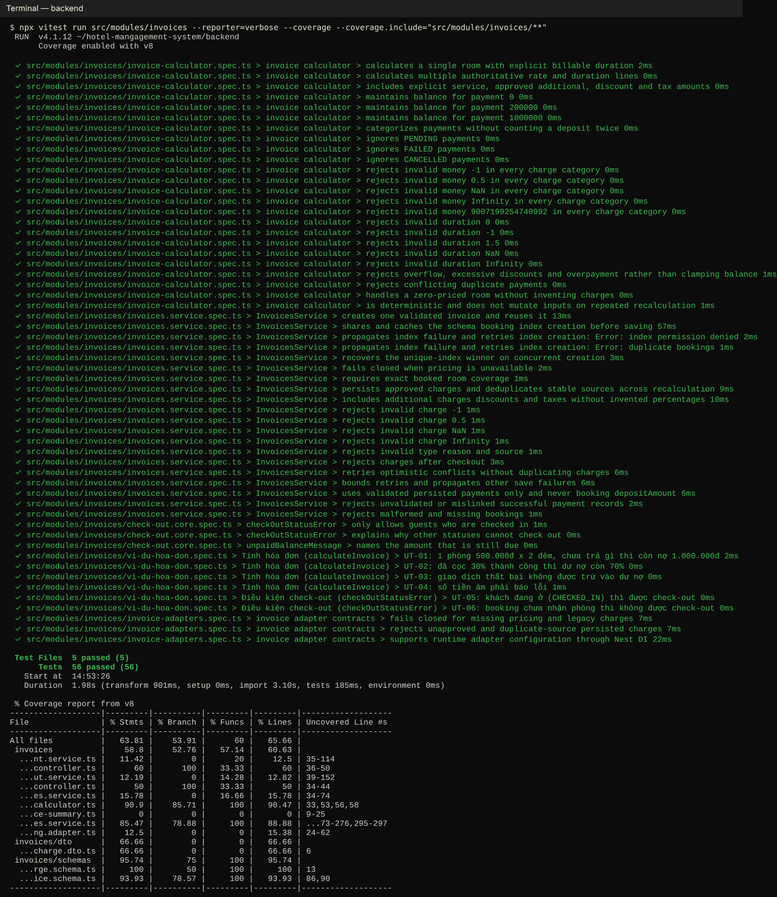
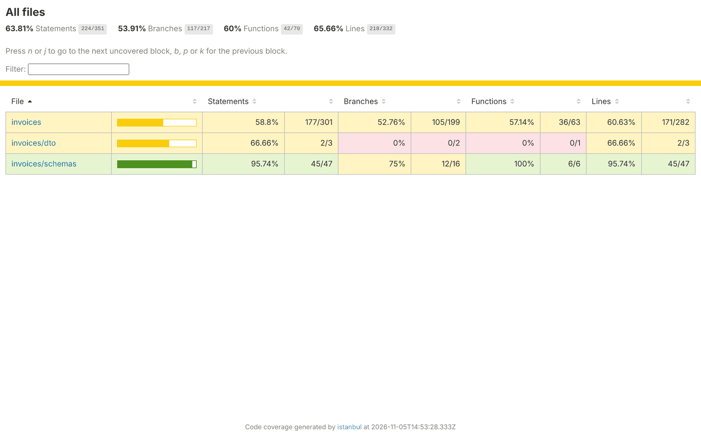
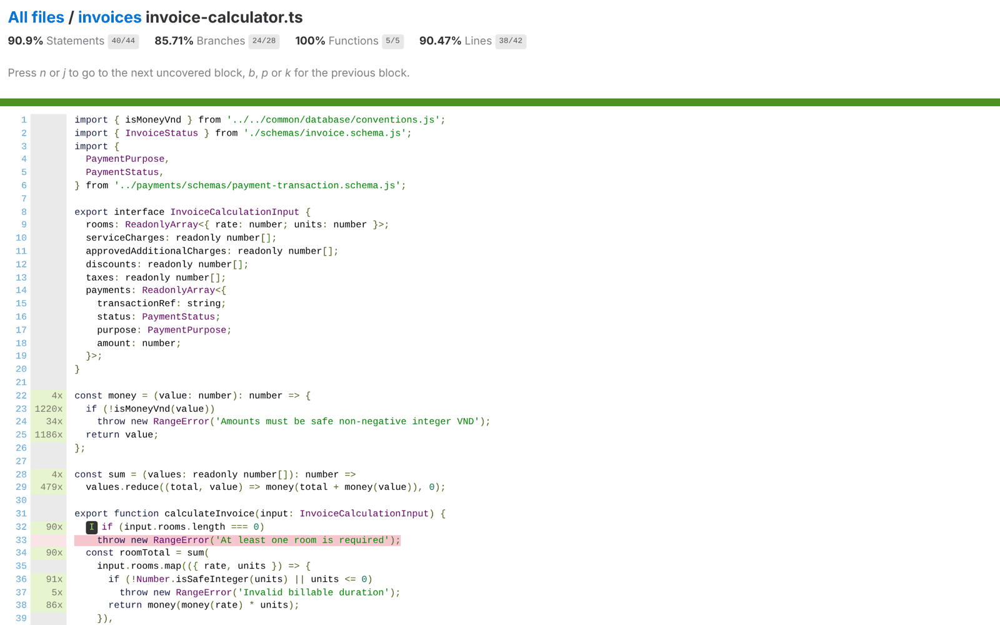

# Hướng dẫn chạy unit test và chụp ảnh kết quả

Dành cho cả nhóm khi nộp phần unit test cho thầy. Đọc mục 1 và 2 là chạy được; mục 3 nói cách viết thêm test; mục 4 là lệnh riêng cho từng người.

Repo đã có sẵn khoảng 1.100 unit test backend và 740 test frontend, tất cả đang pass (kiểm tra ngày 05/11/2026 trên `main`). Việc của mỗi người là **chạy test phần mình làm, chụp kết quả và báo cáo coverage**, viết thêm vài test nếu coverage phần mình thấp.

## 1. Chuẩn bị (làm một lần)

1. Cài Node 24 (`node -v` phải ra `v24.x`, `npm -v` ra `11.x`).
2. Lấy code mới nhất và cài thư viện:

```bash
git checkout main
git pull
cd backend
npm ci
cd ../frontend
npm ci
```

Unit test **không cần** MongoDB, Firebase hay VNPay. Chỉ test e2e (`npm run test:e2e`) mới cần MongoDB.

## 2. Chạy test và chụp ảnh

Mở terminal (PowerShell, CMD hoặc terminal của VS Code) trong thư mục `backend`.

| Muốn làm gì | Lệnh |
|---|---|
| Chạy toàn bộ unit test backend | `npm test` |
| Chạy và in tên từng test (để chụp ảnh) | `npx vitest run --reporter=verbose` |
| Chạy kèm coverage toàn bộ | `npm run test:cov` |
| Chạy một file | `npx vitest run src/modules/invoices/vi-du-hoa-don.spec.ts --reporter=verbose` |
| Chạy một module kèm coverage của module đó | `npx vitest run src/modules/invoices --reporter=verbose --coverage --coverage.include="src/modules/invoices/**"` |

Frontend làm tương tự trong thư mục `frontend` (`npm test`, `npm run test:cov`).

Luôn để đường dẫn sau `--coverage.include=` trong dấu ngoặc kép như trên, để lệnh chạy giống nhau trên mọi loại terminal.

### Ảnh cần chụp

Mỗi người nộp 3 ảnh cho phần mình (lệnh ở mục 4):

**Ảnh 1: kết quả chạy test trong terminal.** Phải thấy được câu lệnh, danh sách test có dấu ✓ và dòng cuối `Tests  N passed (N)`. Nếu dài quá một màn hình thì chụp 2 ảnh: phần đầu (lệnh + vài test đầu) và phần cuối (tổng kết + bảng coverage).



**Ảnh 2: trang tổng coverage.** Sau khi chạy lệnh có `--coverage`, mở file `backend/coverage/index.html` (hoặc `frontend/coverage/index.html`) bằng trình duyệt: bấm đúp vào file trong File Explorer, hoặc trong VS Code chuột phải > Reveal in File Explorer. Chụp phần có 4 chỉ số Statements, Branches, Functions, Lines.



**Ảnh 3: coverage chi tiết một file.** Bấm vào thư mục rồi vào một file của mình. Dòng xanh là đã được test chạy qua, dòng đỏ là chưa. Chụp file quan trọng nhất của mình.



Mẹo chụp: Windows dùng `Win + Shift + S`. Phóng to terminal toàn màn hình trước khi chụp, đặt tên ảnh theo mẫu `UT_<Tên>_1_ket-qua.png`.

Ý nghĩa 4 chỉ số coverage:

- **Statements / Lines**: bao nhiêu % câu lệnh / dòng code đã được test chạy qua.
- **Branches**: bao nhiêu % nhánh `if/else`, `switch`, `? :` đã đi qua cả hai phía.
- **Functions**: bao nhiêu % hàm đã được gọi ít nhất một lần.

Unit test chủ yếu phủ phần logic thuần (tính tiền, kiểm tra trạng thái, quy tắc nghiệp vụ). Service gọi database được kiểm tra bằng test e2e nên coverage unit của file `*.service.ts` thấp là bình thường. Khi báo cáo, ghi coverage của các file logic chính của mình.

## 3. Cách viết một unit test

Dự án dùng **Vitest** (cú pháp giống Jest). File test đặt cạnh file code, tên kết thúc bằng `.spec.ts` (backend) hoặc `.test.tsx` (frontend). Vitest tự tìm các file này.

File mẫu chạy được: [`backend/src/modules/invoices/vi-du-hoa-don.spec.ts`](../backend/src/modules/invoices/vi-du-hoa-don.spec.ts). Rút gọn:

```ts
import { describe, it, expect } from 'vitest';
import { calculateInvoice } from './invoice-calculator.js';
import { InvoiceStatus } from './schemas/invoice.schema.js';

describe('Tính hóa đơn (calculateInvoice)', () => {
  it('UT-01: 1 phòng 500.000đ x 2 đêm, chưa trả gì thì còn nợ 1.000.000đ', () => {
    // Arrange: chuẩn bị dữ liệu đầu vào
    const input = {
      rooms: [{ rate: 500_000, units: 2 }],
      serviceCharges: [],
      approvedAdditionalCharges: [],
      discounts: [],
      taxes: [],
      payments: [],
    };

    // Act: gọi hàm cần test
    const invoice = calculateInvoice(input);

    // Assert: so sánh kết quả với mong đợi
    expect(invoice.roomTotal).toBe(1_000_000);
    expect(invoice.balanceDue).toBe(1_000_000);
    expect(invoice.status).toBe(InvoiceStatus.Unpaid);
  });

  it('UT-04: số tiền âm phải báo lỗi', () => {
    expect(() =>
      calculateInvoice({ rooms: [{ rate: -1, units: 1 }], serviceCharges: [], approvedAdditionalCharges: [], discounts: [], taxes: [], payments: [] }),
    ).toThrow();
  });
});
```

Ghi nhớ:

- `describe` gom nhóm test của một hàm, `it` là một test case. Đặt tên `it` bằng tiếng Việt, có mã `UT-xx` để khớp với bảng báo cáo.
- Mỗi test theo 3 bước **Arrange, Act, Assert**.
- Các hàm hay dùng: `toBe` (bằng đúng), `toEqual` / `toMatchObject` (so object), `toBeNull`, `toThrow` (phải báo lỗi), `toHaveBeenCalledWith` (mock đã được gọi với tham số).
- Import trong backend phải có đuôi `.js` (dự án dùng ESM), dù file thật là `.ts`.
- Chọn hàm để test: ưu tiên hàm thuần trong các file `*.core.ts`, `*-calculator.ts`, `*.pipeline.ts` (không gọi database). Mỗi hàm viết ít nhất: 1 trường hợp đúng, 1 trường hợp biên, 1 trường hợp lỗi.
- Test service có gọi database: xem cách mock model trong `src/modules/users/users.service.spec.ts` hoặc `src/modules/invoices/invoices.service.spec.ts`.
- Frontend: xem mẫu `frontend/src/components/ConfirmationDialog.test.tsx` (render component bằng Testing Library rồi kiểm tra chữ hiện ra, bấm nút).

Viết xong chạy `npx vitest run <đường dẫn file> --reporter=verbose`, thấy pass thì commit kèm code.

## 4. Lệnh cho từng người

Chạy trong thư mục `backend` (trừ dòng ghi frontend). Mỗi lệnh in kết quả từng test, bảng coverage, và tạo lại thư mục `coverage/` để chụp ảnh 2 và 3. Số liệu bên phải là kết quả chạy thử ngày 05/11/2026.

| Người | Phần | Lệnh | Kết quả chạy thử |
|---|---|---|---|
| Vũ Ngọc Dương | Đăng nhập, tài khoản, phân quyền | `npx vitest run src/modules/auth src/modules/users src/modules/roles --reporter=verbose --coverage --coverage.include="src/modules/auth/**" --coverage.include="src/modules/users/**" --coverage.include="src/modules/roles/**"` | 27 test pass, coverage 46% |
| Nguyễn Công Hiếu | Tìm phòng, booking, hoá đơn, VNPay | `npx vitest run src/modules/bookings src/modules/invoices src/modules/payments --reporter=verbose --coverage --coverage.include="src/modules/bookings/**" --coverage.include="src/modules/invoices/**" --coverage.include="src/modules/payments/**"` | 203 test pass, coverage 46% |
| Nguyễn Đăng Khoa | Check-in/out, sơ đồ phòng, dashboard lễ tân | `npx vitest run check-in.core room-status-board.core check-out.core reception-dashboard --reporter=verbose --coverage --coverage.include="src/modules/bookings/check-in*" --coverage.include="src/modules/bookings/room-status-board*" --coverage.include="src/modules/invoices/check-out*" --coverage.include="src/modules/dashboard/reception-dashboard*"` | 27 test pass, coverage 37% |
| Nguyễn Đăng Khoa (frontend) | Layout, routing theo role | Trong `frontend`: `npx vitest run src/layouts src/app --reporter=verbose --coverage --coverage.include="src/layouts/**" --coverage.include="src/app/**"` | 56 test pass, coverage 95% |
| Lê Anh Vũ | Task, dịch vụ, sự cố | `npx vitest run src/modules/tasks src/modules/service-orders src/modules/issues --reporter=verbose --coverage --coverage.include="src/modules/tasks/**" --coverage.include="src/modules/service-orders/**" --coverage.include="src/modules/issues/**"` | 400 test pass, coverage 67% |
| Trần Bảo Lâm | Cơ sở vật chất, bảo trì, báo cáo, thông báo | `npx vitest run src/modules/room-types src/modules/rooms src/modules/amenities src/modules/services src/modules/maintenance src/modules/reports src/modules/task-supervision src/modules/dashboard src/modules/notifications --reporter=verbose --coverage --coverage.include="src/modules/room-types/**" --coverage.include="src/modules/rooms/**" --coverage.include="src/modules/amenities/**" --coverage.include="src/modules/services/**" --coverage.include="src/modules/maintenance/**" --coverage.include="src/modules/reports/**" --coverage.include="src/modules/task-supervision/**"` | 423 test pass, coverage 71% |

Phần của Dương, Hiếu, Khoa có coverage unit thấp vì nhiều logic nằm trong service và đã được kiểm tra bằng e2e. Nên viết thêm unit test cho các hàm thuần (ví dụ `availability.core.ts`, `check-in.core.ts`, guard trong `auth/`) trước khi chụp ảnh nộp.

Ảnh tổng của cả nhóm (người lead chụp): trong `backend` chạy `npm run test:cov`, trong `frontend` chạy `npm run test:cov`. Ngày 05/11/2026 kết quả là backend 1.105/1.105 test pass, coverage dòng 70%; frontend 744/744 pass, coverage dòng 91%.

## 5. Gặp lỗi thường gặp

| Lỗi | Cách sửa |
|---|---|
| `'vitest' is not recognized` hoặc `Cannot find module` | Chưa `npm ci` trong đúng thư mục `backend` / `frontend`. |
| `npm ci` báo lỗi lockfile | Đang dùng npm 10. Cài Node 24 (đi kèm npm 11). |
| `Failed to load url ... coverage-v8` | Thư viện coverage chưa cài: chạy lại `npm ci`. |
| Coverage báo 0% hoặc `All files` trống | Đường dẫn `--coverage.include` sai, kiểm tra lại tên thư mục và dấu ngoặc kép. |
| Không mở được `coverage/index.html` | File chỉ có sau khi chạy lệnh có `--coverage`; mở bằng Chrome/Edge. |
| Test e2e báo không kết nối MongoDB | Đó là `npm run test:e2e`, không phải unit test. Cần MongoDB chạy và `MONGODB_URI` có tên DB kết thúc bằng `test`, ví dụ `mongodb://127.0.0.1:27017/hms_test`. |

Thư mục `coverage/` đã nằm trong `.gitignore`, không commit lên git.
